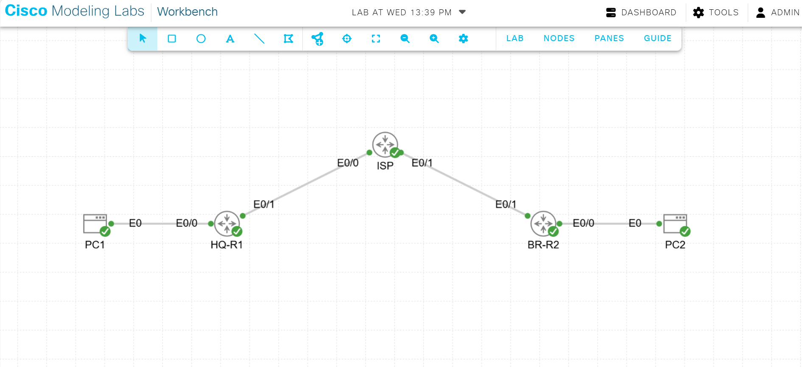

# Site-to-Site IPsec VPN with NAT/PAT in Cisco CML

A site-to-site IPsec VPN between an HQ and a Branch network across a simulated ISP. Private LAN traffic is encrypted with ESP, internet access still works through PAT, and a packet capture proves it.



## Objective

- Connect `192.168.10.0/24` (HQ) and `192.168.20.0/24` (Branch) over a simulated ISP that has **no routes to private networks**.
- Encrypt LAN-to-LAN traffic with IPsec (IKEv1, crypto map, ESP tunnel mode).
- Keep internet access working through PAT, with VPN traffic exempted from NAT.
- Prove the encryption with a packet capture on the WAN link.

## Technologies

| Area | Details |
|---|---|
| VPN | IPsec, IKEv1 (ISAKMP), crypto map, ESP in tunnel mode |
| Phase 1 | AES-256, SHA-256, DH group 14, pre-shared key |
| Phase 2 | `esp-aes 256` + `esp-sha256-hmac` |
| NAT | PAT (overload) on the WAN interface with a VPN exemption |
| Platform | Cisco Modeling Labs (CML Free), IOL routers (IOS XE 17.18), Alpine Linux hosts |

## IP addressing plan

| Device | Interface | IP address | Connects to |
|---|---|---|---|
| PC1 (Alpine) | eth0 | 192.168.10.10/24 | HQ-R1 e0/0 |
| HQ-R1 | e0/0 | 192.168.10.1/24 | PC1 |
| HQ-R1 | e0/1 | 203.0.113.1/30 | ISP e0/0 |
| ISP | e0/0 | 203.0.113.2/30 | HQ-R1 |
| ISP | e0/1 | 198.51.100.1/30 | BR-R2 e0/1 |
| ISP | Loopback0 | 8.8.8.8/32 | Simulated internet |
| BR-R2 | e0/1 | 198.51.100.2/30 | ISP |
| BR-R2 | e0/0 | 192.168.20.1/24 | PC2 |
| PC2 (Alpine) | eth0 | 192.168.20.10/24 | BR-R2 e0/0 |

The ISP only has its own connected networks and a loopback. It cannot route to either LAN, so the VPN is the only way the two sites can talk privately.

## How it works

### Phase 1: IKE (ISAKMP)
The two routers authenticate each other with a pre-shared key and negotiate a secure management channel using the ISAKMP policy (AES-256, SHA-256, DH group 14). This is Main Mode, six messages. Success shows as `QM_IDLE` / `ACTIVE` in `show crypto isakmp sa`.

### Phase 2: IPsec
Inside the Phase 1 channel, Quick Mode negotiates the IPsec SAs for the data tunnel using transform set `TS-AES` (ESP with AES-256 and SHA-256 HMAC, tunnel mode). Traffic is then encapsulated in ESP.

### Interesting traffic and crypto ACLs
The `VPN-TRAFFIC` ACL defines which traffic gets encrypted: HQ LAN to Branch LAN. Each router's ACL is the mirror image of its peer's, otherwise Phase 2 will not match.

### Why NAT is exempted
Both routers run PAT so the LANs can reach the internet. `NAT-ACL` **denies** LAN-to-LAN traffic first and permits the rest. Without that deny line, VPN traffic would be translated before it could match the crypto ACL, and the tunnel would never carry traffic.

## Configuration

Full sanitized configs (pre-shared key replaced with `<PSK>`):

- [`configs/HQ-R1.txt`](configs/HQ-R1.txt)
- [`configs/ISP.txt`](configs/ISP.txt)
- [`configs/BR-R2.txt`](configs/BR-R2.txt)

Key excerpt from HQ-R1:

```
crypto isakmp policy 10
 encryption aes 256
 hash sha256
 authentication pre-share
 group 14
crypto isakmp key <PSK> address 198.51.100.2
!
crypto ipsec transform-set TS-AES esp-aes 256 esp-sha256-hmac
 mode tunnel
!
crypto map CMAP 10 ipsec-isakmp
 set peer 198.51.100.2
 set transform-set TS-AES
 match address VPN-TRAFFIC
!
ip access-list extended NAT-ACL
 10 deny ip 192.168.10.0 0.0.0.255 192.168.20.0 0.0.0.255
 20 permit ip 192.168.10.0 0.0.0.255 any
ip access-list extended VPN-TRAFFIC
 10 permit ip 192.168.10.0 0.0.0.255 192.168.20.0 0.0.0.255
```

The lab can be re-imported into CML from [`topology/IPsec-Site-to-Site-VPN.yaml`](topology/IPsec-Site-to-Site-VPN.yaml).

## Verification

All screenshots are in [`evidence/`](evidence/), with an index in [`evidence/README.md`](evidence/README.md).

### Before the VPN (baseline)

| Check | Result | Evidence |
|---|---|---|
| Interfaces and addressing | All up with the planned IPs | [HQ](evidence/01-baseline/01-hq-interfaces.png), [ISP](evidence/01-baseline/02-isp-interfaces.png), [Branch](evidence/01-baseline/03-br-interfaces.png) |
| ISP routing table | Only connected routes, none for 192.168.x.x | [ISP routes](evidence/01-baseline/07-isp-route-table.png) |
| Internet access via PAT | PC1 reaches 8.8.8.8 | [Ping](evidence/01-baseline/08-pc1-ping-internet.png), [NAT table](evidence/01-baseline/09-hq-nat-translations.png) |
| WAN reachability | HQ-R1 reaches BR-R2's WAN IP through the ISP | [Ping](evidence/01-baseline/10-hq-ping-br-wan.png) |

### After the VPN

| Check | Result | Evidence |
|---|---|---|
| PC1 to PC2 | Replies received (first packet lost while IKE negotiated, 4 of 5 received) | [Ping](evidence/02-vpn-verification/01-pc1-ping-pc2-success.png) |
| Phase 1 | `QM_IDLE`, `ACTIVE` on both routers | [HQ-R1](evidence/02-vpn-verification/02-isakmp-sa-hq.png), [BR-R2](evidence/02-vpn-verification/03-isakmp-sa-br.png) |
| Phase 2 | ESP SAs up, encaps/decaps counters increasing | [HQ-R1](evidence/02-vpn-verification/04-ipsec-sa-hq.png), [BR-R2](evidence/02-vpn-verification/05-ipsec-sa-br.png) |
| Crypto map and policy | `CMAP` applied to e0/1, ISAKMP policy listed | [Map](evidence/02-vpn-verification/06-crypto-map-hq.png), [Policy](evidence/02-vpn-verification/08-isakmp-policy.png) |
| Interesting traffic | `VPN-TRAFFIC` ACL showing matches | [ACL](evidence/02-vpn-verification/07-crypto-acl.png) |
| Traceroute | The ISP does not appear as a hop | [Traceroute](evidence/02-vpn-verification/09-traceroute.png) |
| Internet still works | PAT keeps working next to the VPN | [Ping](evidence/02-vpn-verification/10-internet-still-works.png), [NAT table](evidence/02-vpn-verification/11-nat-translations-after.png) |

On HQ-R1, `show crypto ipsec sa` showed 24 packets encapsulated and 21 decapsulated, and the `VPN-TRAFFIC` ACL showed 28 matches.

### Proof of encryption

Captured on the HQ-R1 to ISP link:

| VPN traffic | Internet traffic |
|---|---|
| ISAKMP Main Mode and Quick Mode, then **ESP** between 203.0.113.1 and 198.51.100.2 | Plain **ICMP** from 203.0.113.1 (PAT address) to 8.8.8.8 |
| [Capture](evidence/03-packet-capture/01-esp-capture.png), [packet detail](evidence/03-packet-capture/02-esp-packet-detail.png) | [Capture](evidence/03-packet-capture/03-plain-icmp-capture.png) |

The ESP packet detail shows only an "Encapsulating Security Payload" layer with no readable ICMP or private addresses, while the internet traffic is fully readable. Raw captures are in [`evidence/03-packet-capture/`](evidence/03-packet-capture/) (`vpn-esp.pcap`, `internet-icmp.pcap`) for Wireshark.

## Troubleshooting

Fault-injection practice (wrong pre-shared key, Phase 1 and Phase 2 mismatches, crypto ACL, NAT exemption, wrong peer) is tracked in [`troubleshooting.md`](troubleshooting.md). This section is in progress.

## What I learned

- Phase 1 and Phase 2 are separate negotiations, so a tunnel can fail at either stage and the symptoms differ.
- Crypto ACLs must mirror each other on both peers.
- NAT order matters: VPN traffic has to be exempted from PAT before it can match the crypto ACL.
- Verifying with `show crypto isakmp sa`, `show crypto ipsec sa` counters, and a packet capture gives much stronger proof than a successful ping alone.

## Possible extensions

- GRE over IPsec with OSPF running across the tunnel (same five nodes).
- IKEv2 or a virtual tunnel interface (VTI) version for comparison.
- Fault-injection write-ups for each failure mode.

## Repository layout

```
ipsec-site-to-site-vpn/
├── README.md
├── troubleshooting.md
├── configs/          sanitized running configs
├── evidence/         screenshots and packet captures
├── topology/         CML canvas screenshot and lab .yaml
└── .gitignore
```
